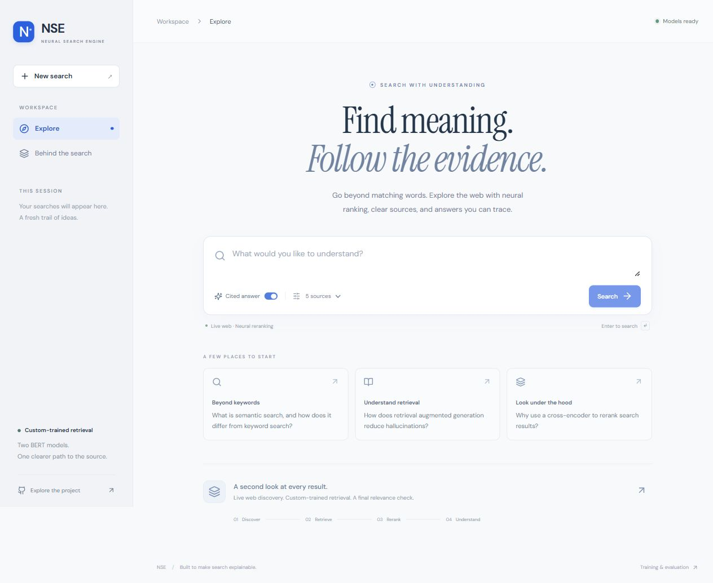
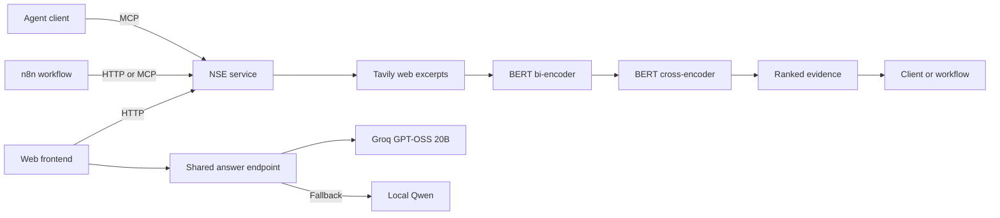

# Neural Search Engine

**Custom-trained neural retrieval, an interactive search workspace, and an agent-callable service.**

A query goes from live search to a bi-encoder shortlist and cross-encoder
reranking. The service returns evidence with source IDs, URLs, relevance scores,
and timings. An optional workflow passes that evidence to local Qwen for a cited
answer. The web frontend shows sources first, then generates a cited answer using
Groq with local Ollama fallback. Both ranking models stay loaded between requests.

[Demo screenshots](docs/demo-gallery.md) · [Run locally](#run-locally) · [Workflow guide](docs/prototype.md) ·
[Evaluation](evals/results/2026-09-21-tavily.md) ·
[Training and technical reference](TECHNICAL_REFERENCE.md) ·
[Validation record](docs/prototype-validation.md)

**On-demand hosted demo:** [Open NSE](https://neural-search-engine-grazic.vercel.app) (no sign-in required;
host PC must be online). [Hosting, restart, and MCP access](docs/deployment.md).



*The local web interface uses the same trained ranking pipeline as HTTP, MCP,
and n8n clients. [Website setup and architecture](docs/frontend.md).*

## What is implemented

- **Interactive frontend:** React/TypeScript search, cited answers, source links,
  expandable excerpts, ranking details, real stage timings, and session history.
- **Trained model inference:** BERT bi-encoder retrieval and cross-encoder reranking,
  with versioned Kaggle checkpoints and strict weight loading.
- **Agent and workflow interfaces:** an MCP `neural_search` tool and HTTP search
  endpoint sharing one resident Python pipeline.
- **Shared answer endpoint:** Groq-first generation with Ollama fallback, validated
  citations, provider metadata, and preserved evidence when generation fails.
- **Three n8n workflows:** HTTP retrieval, native MCP retrieval, and retrieval
  followed by local `qwen3:4b` answer generation with source citations.
- **Reproducible evaluation:** frozen candidate pools, resumable local LLM judging,
  ranking comparisons, and an export for human review.

**Stack:** Python · PyTorch · Transformers · React · TypeScript · Vite · MCP · Starlette · n8n · Groq · Ollama · Tavily · uv

## Model fine-tuning

The project includes **100+ hours across model setup, training, and
experimentation**, spanning a BERT bi-encoder, BERT cross-encoder, and T5-small
query rewriter. The work covers data preparation, training objectives, checkpoint
selection, retrieval evaluation, and loading the trained weights into the service.
This is an author-reported effort estimate; it is not GPU-hour telemetry.

| Model | Training work | Recorded result |
| --- | --- | --- |
| BERT bi-encoder | 200,000 MS MARCO query–positive–negative triples; contrastive InfoNCE training with in-batch negatives and a learned projection | Best recorded Recall@10: **0.9760**, on a 1,000-query sample against 9,945 passages |
| BERT cross-encoder | 1,783,707 expanded triples; pairwise margin-ranking training and checkpoint selection | Recorded nDCG@10 improved from **0.5025 to 0.6906** after reranking the dense top 50 |
| T5-small query rewriter | 200,000 synthetic noisy/clean query pairs; sequence-to-sequence fine-tuning | Tested but excluded from the runtime: v1 did not provide sufficient reliable retrieval benefit |

These are constructed MS MARCO validation experiments, not leaderboard results.
The reranker evaluation uses the first 500 validation pair rows, which can repeat
queries. Live-web evaluation is reported separately below.
[Training settings, notebooks, checkpoint provenance, and evaluation details](TECHNICAL_REFERENCE.md#training-and-recorded-results).

## Architecture



The default pipeline requests **20 candidates**, reranks **up to 10**, and returns
**up to 5 sources**. It ranks web excerpts, not full destination pages. The n8n
examples are deterministic workflows; an external agent can discover and call
the MCP tool.

## Demo output


*An actual browser execution using Tavily, both local BERT models, and Groq.
Citation IDs provide traceability; factual verification is not performed.*

[Inspect the matching source, model scores, and native MCP execution →](docs/demo-gallery.md)

## Evaluation

All **30 queries** completed in the recorded Tavily evaluation:

| Ranking | nDCG@5 | Precision@5 | Mean retrieval latency |
| --- | ---: | ---: | ---: |
| Tavily provider order | 0.8788 | 0.96 | 3.17 s |
| Bi-encoder | 0.7153 | 0.82 | 6.57 s |
| Bi-encoder + cross-encoder | 0.8711 | 0.96 | 8.25 s |

**The trained pipeline did not outperform Tavily in this run.** Cross-encoder
reranking recovered most of the dense stage's quality loss, but added latency.
Labels came from an unvalidated local `qwen3:4b` judge; these results measure
snippet relevance, not factual answer correctness. Latency excludes model startup
and answer generation. [Exact results and run provenance](evals/results/2026-09-21-tavily.md).

## Run locally

Prerequisites: **uv**, **Node.js 22.12+ with npm**, and internet access for live
search and initial downloads. Run the following commands
from the repository root in PowerShell. uv selects Python 3.11 and CPU
PyTorch. Ranking weights occupy roughly 0.9 GB on disk; this is not a RAM estimate.

```powershell
uv sync --locked
uv run python -m nse download-models  # First setup only
npm --prefix frontend ci
npm --prefix frontend run build
uv run serve.py
```

Wait for `Application startup complete`, then open **http://127.0.0.1:8000**.
Enter a question or choose an example. Turn **Cited answer** off for retrieval
only. **Ranking details** shows each source's position through the pipeline.
For Groq answers, configure `GROQ_API_KEY` in `.env`; see the section below.

### Restart the hosted demo after rebooting

After the initial [hosting setup](docs/deployment.md), open PowerShell in the
repository root and start the PC backend and tunnel:

```powershell
uv run scripts/demo_host.py
```

Leave that terminal open. Once it prints **Demo host ready**, open a second
terminal in the same folder and run:

```powershell
uv run scripts/deploy_demo.py
```

Every host restart creates a new tunnel address, so the second command is
required. The public URL stays **https://neural-search-engine-grazic.vercel.app**.
Reviewers can open the link directly. Keep the PC powered and online. Start Ollama separately if you want the local answer fallback; Groq
does not require it. Normal local use still needs only `uv run serve.py`.

The hosted link has no scheduled expiry or automatic deletion. The website stays
available while your PC is off; search, answers, and MCP need the backend online.
Use the same two commands whenever you want to give another demo.
Vercel receives CLI uploads directly from the local frontend folder; GitHub
auto-deployment is not connected.

### Optional n8n interface

With the service running, open another terminal:

```powershell
./n8n.ps1 Install  # First setup only
./n8n.ps1 Import   # Imports the supplied demos; repeating replaces their IDs
./n8n.ps1 Start
```

Open `http://localhost:5678`, complete local owner setup if prompted, and run
**NSE - MCP ranked evidence**. Edit **Demo query** and inspect **Rank sources**.
The service endpoint is `http://127.0.0.1:8000/mcp`; HTTP search is `POST /search`.
Ollama is needed only for **NSE - cited local answer**, with `qwen3:4b` installed
and its API running on port 11434, or for the shared answer endpoint's fallback.

Tavily uses rate-limited keyless access by default. An optional `TAVILY_API_KEY`
can be set in the ignored `.env` file. See [provider setup](docs/tavily.md).
For existing n8n installations, import the files in [workflows/](workflows/).
The supplied URLs assume native services on the same PC, not n8n Cloud or Docker.

A smaller CLI demonstration is available with `uv run demo.py`. To exercise the
MCP interface directly while the service is running:

```powershell
uv run mcp_demo.py "What is semantic search?"
```

### Groq answers with local fallback

Set `GROQ_API_KEY` in the ignored `.env` file, using [.env.dist](.env.dist) as the
configuration reference, and restart the service. The default Groq model is
`openai/gpt-oss-20b`; override it with `GROQ_MODEL`. For local fallback, run
Ollama with `qwen3:4b` installed (or set `OLLAMA_MODEL`). No new Python SDK is needed.

```powershell
Invoke-RestMethod -Method Post -Uri http://127.0.0.1:8000/answer `
  -ContentType 'application/json' `
  -Body '{"query":"What is semantic search?","top":5}'
```

This runs retrieval once, then attempts Groq and, if needed, Ollama using the same
evidence. The response includes `answer_status`, `answer`, `provider`, `model`,
`fallback_used`, safe failure codes in `attempts`, and the complete `evidence`.
If both providers fail, HTTP 200 still returns the successful retrieval with
`answer_status: "unavailable"` and `answer: null`. Clients must check that status.
Empty search results return `no_sources` without calling either LLM.

Groq receives the query and selected source excerpts through the backend; the key
never belongs in browser code. The existing local-only n8n answer demo remains
available. [Endpoint contract, fallback behavior, and validation](docs/answers.md).

## Validation and limits

The [recorded validation](docs/prototype-validation.md) includes **36 passing
Python checks** and successful executions of all three n8n workflows. Seven
additional JavaScript regression tests exercise the answer workflow's request
and validation code. With the shared answer endpoint, the suite now includes
**51 passing Python tests and 9 passing JavaScript tests** (2026-10-10);
[answer-layer validation](docs/answers.md#validation) uses mocked providers.
Run the tests with:

```powershell
uv run python -m unittest discover -s tests -v
node --test tests/workflow-answer.test.cjs
npm --prefix frontend test
```

- Source IDs and citation checks provide traceability, not factual verification.
- The service handles one search at a time and binds to localhost. It is a local
  prototype without a public authentication layer.

## Explore the implementation

| Area | Entry point |
| --- | --- |
| Frontend and local development | [frontend/](frontend/), [website guide](docs/frontend.md) |
| Ranking pipeline and model loading | [nse/search.py](nse/search.py), [nse/models.py](nse/models.py) |
| MCP and HTTP service | [nse/service.py](nse/service.py) |
| Groq/Ollama answers and fallback | [nse/answers.py](nse/answers.py), [answer API guide](docs/answers.md) |
| Importable workflows | [workflows/](workflows/) |
| Evaluation runner and protocol | [evals/README.md](evals/README.md) |
| Dataset download utility | [scripts/download_training_data.py](scripts/download_training_data.py) |
| Training notebooks and recorded experiments | [Technical reference](TECHNICAL_REFERENCE.md#training-and-recorded-results) |
| Local workflow setup and troubleshooting | [Prototype guide](docs/prototype.md) |

[MIT license](LICENSE).
