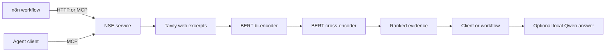

# Neural Search Engine

**From custom model fine-tuning to an agent-callable search service: BERT retrieval and reranking, MCP, and n8n workflows.**

A query goes from live search to a bi-encoder shortlist and cross-encoder
reranking. The service returns evidence with source IDs, URLs, relevance scores,
and timings. An optional workflow passes that evidence to local Qwen for a cited
answer. Both ranking models stay loaded between requests.

[Demo screenshots](docs/demo-gallery.md) · [Run locally](#run-locally) · [Workflow guide](docs/prototype.md) ·
[Evaluation](evals/results/2026-09-21-tavily.md) ·
[Training and technical reference](TECHNICAL_REFERENCE.md) ·
[Validation record](docs/prototype-validation.md)


*An actual local execution of the six-node answer workflow. The trained BERT
models run inside the NSE service called by **Rank sources**.*

## What is implemented

- **Trained model inference:** BERT bi-encoder retrieval and cross-encoder reranking,
  with versioned Kaggle checkpoints and strict weight loading.
- **Agent and workflow interfaces:** an MCP `neural_search` tool and HTTP search
  endpoint sharing one resident Python pipeline.
- **Three n8n workflows:** HTTP retrieval, native MCP retrieval, and retrieval
  followed by local `qwen3:4b` answer generation with source citations.
- **Reproducible evaluation:** frozen candidate pools, resumable local LLM judging,
  ranking comparisons, and an export for human review.

**Stack:** Python · PyTorch · Transformers · MCP · Starlette · n8n · Ollama · Tavily · uv

## Model fine-tuning

The project includes **100+ hours across model setup, training, and
experimentation**, spanning a BERT bi-encoder, BERT cross-encoder, and T5-small
query rewriter. The work covers data preparation, training objectives, checkpoint
selection, retrieval evaluation, and loading the trained weights into the service.
This is an author-reported effort estimate; it is not GPU-hour telemetry.

| Model | Training work | Recorded result |
| --- | --- | --- |
| BERT bi-encoder | 200,000 MS MARCO query–positive–negative triples; contrastive InfoNCE training with in-batch negatives and a learned projection | Best recorded Recall@10: **0.9760**, on a 1,000-query sample against 9,945 passages |
| BERT cross-encoder | 1,783,707 expanded triples; pairwise margin-ranking training and checkpoint selection | Recorded nDCG@10 improved from **0.5025 to 0.6906** after reranking the dense top 50 |
| T5-small query rewriter | 200,000 synthetic noisy/clean query pairs; sequence-to-sequence fine-tuning | Tested but excluded from the runtime: v1 did not provide sufficient reliable retrieval benefit |

These are constructed MS MARCO validation experiments, not leaderboard results.
The reranker evaluation uses the first 500 validation pair rows, which can repeat
queries. Live-web evaluation is reported separately below.
[Training settings, notebooks, checkpoint provenance, and evaluation details](TECHNICAL_REFERENCE.md#training-and-recorded-results).

## Architecture



The default pipeline requests **20 candidates**, reranks **up to 10**, and returns
**up to 5 sources**. It ranks web excerpts, not full destination pages. The n8n
examples are deterministic workflows; an external agent can discover and call
the MCP tool.

## Demo output


*The workflow returns the question, cited answer, model, and full ranked evidence.
Citation IDs provide traceability; factual verification is explicitly not performed.*

[Inspect the matching source, model scores, and native MCP execution →](docs/demo-gallery.md)

## Evaluation

All **30 queries** completed in the recorded Tavily evaluation:

| Ranking | nDCG@5 | Precision@5 | Mean retrieval latency |
| --- | ---: | ---: | ---: |
| Tavily provider order | 0.8788 | 0.96 | 3.17 s |
| Bi-encoder | 0.7153 | 0.82 | 6.57 s |
| Bi-encoder + cross-encoder | 0.8711 | 0.96 | 8.25 s |

**The trained pipeline did not outperform Tavily in this run.** Cross-encoder
reranking recovered most of the dense stage's quality loss, but added latency.
Labels came from an unvalidated local `qwen3:4b` judge; these results measure
snippet relevance, not factual answer correctness. Latency excludes model startup
and answer generation. [Exact results and run provenance](evals/results/2026-09-21-tavily.md).

## Run locally

Prerequisites: **uv**, internet access for live search and initial downloads,
and **npm** for the supplied Windows n8n installer. Run the following commands
from the repository root in PowerShell. uv selects Python 3.11 and CPU
PyTorch. Ranking weights occupy roughly 0.9 GB on disk; this is not a RAM estimate.

```powershell
uv sync --locked
uv run python -m nse download-models  # First setup only
uv run serve.py
```

Wait for `Application startup complete`. In another terminal:

```powershell
./n8n.ps1 Install  # First setup only
./n8n.ps1 Import   # Imports the supplied demos; repeating replaces their IDs
./n8n.ps1 Start
```

Open `http://localhost:5678`, complete local owner setup if prompted, and run
**NSE - MCP ranked evidence**. Edit **Demo query** and inspect **Rank sources**.
The service endpoint is `http://127.0.0.1:8000/mcp`; HTTP search is `POST /search`.
Ollama is needed only for **NSE - cited local answer**, with `qwen3:4b` installed
and its API running on port 11434.

Tavily uses rate-limited keyless access by default. An optional `TAVILY_API_KEY`
can be set in the ignored `.env` file. See [provider setup](docs/tavily.md).
For existing n8n installations, import the files in [workflows/](workflows/).
The supplied URLs assume native services on the same PC, not n8n Cloud or Docker.

A smaller CLI demonstration is available with `uv run demo.py`. To exercise the
MCP interface directly while the service is running:

```powershell
uv run mcp_demo.py "What is semantic search?"
```

## Validation and limits

The [recorded validation](docs/prototype-validation.md) includes **36 passing
Python checks** and successful executions of all three n8n workflows. Seven
additional JavaScript regression tests exercise the answer workflow's request
and validation code. Run the tests with:

```powershell
uv run python -m unittest discover -s tests -v
node --test tests/workflow-answer.test.cjs
```

- Source IDs and citation checks provide traceability, not factual verification.
- The service handles one search at a time and binds to localhost. It is a local
  prototype without a public authentication layer.

## Explore the implementation

| Area | Entry point |
| --- | --- |
| Ranking pipeline and model loading | [nse/search.py](nse/search.py), [nse/models.py](nse/models.py) |
| MCP and HTTP service | [nse/service.py](nse/service.py) |
| Importable workflows | [workflows/](workflows/) |
| Evaluation runner and protocol | [evals/README.md](evals/README.md) |
| Dataset download utility | [scripts/download_training_data.py](scripts/download_training_data.py) |
| Training notebooks and recorded experiments | [Technical reference](TECHNICAL_REFERENCE.md#training-and-recorded-results) |
| Local workflow setup and troubleshooting | [Prototype guide](docs/prototype.md) |

[MIT license](LICENSE).
