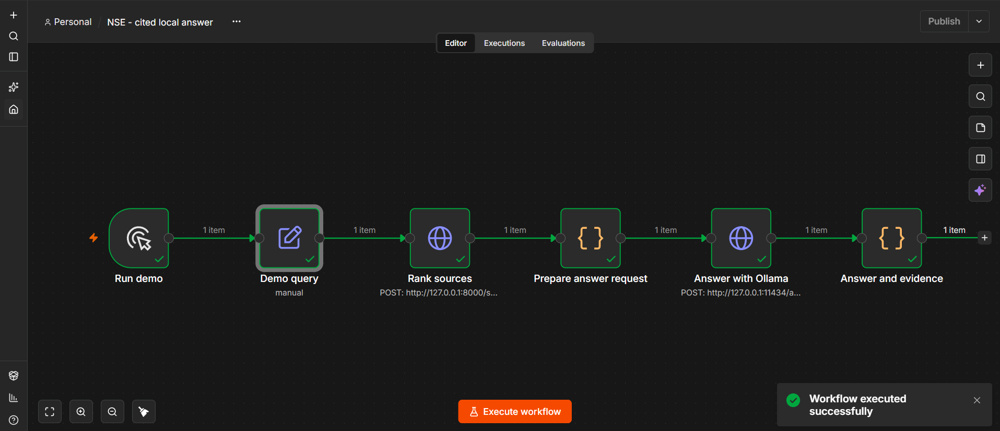
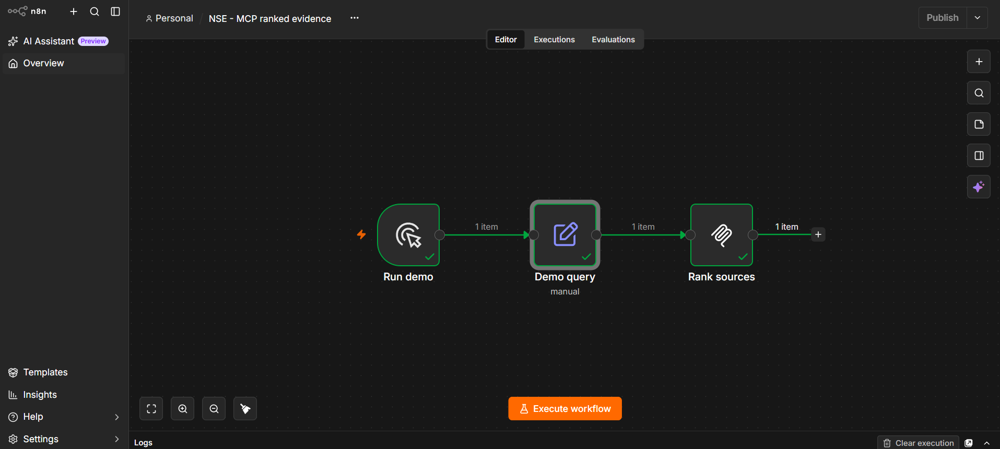
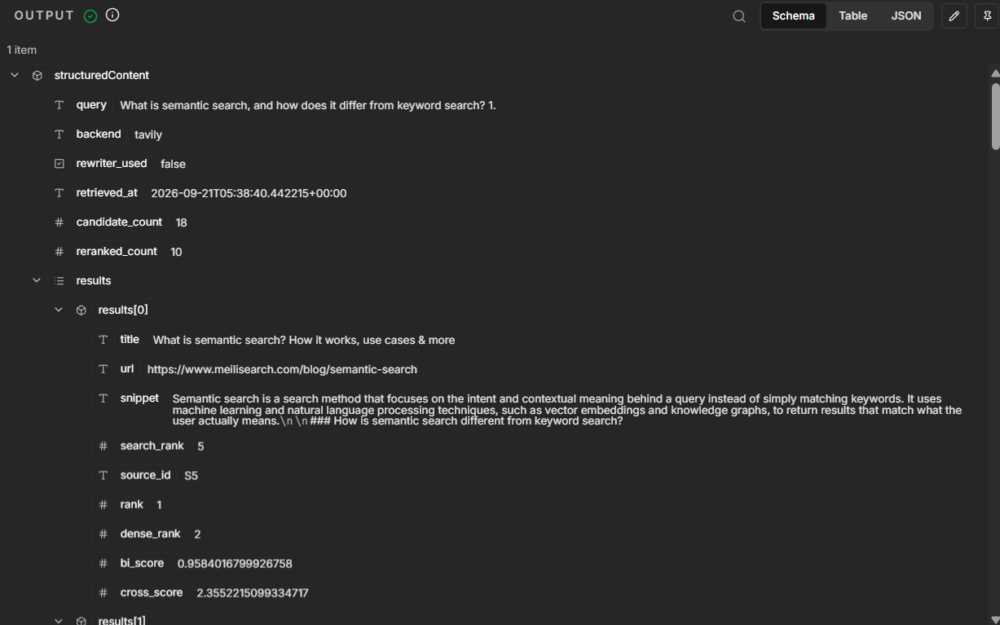
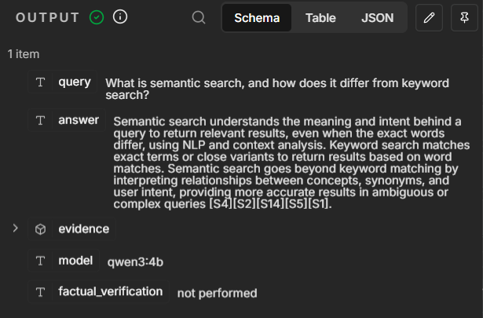
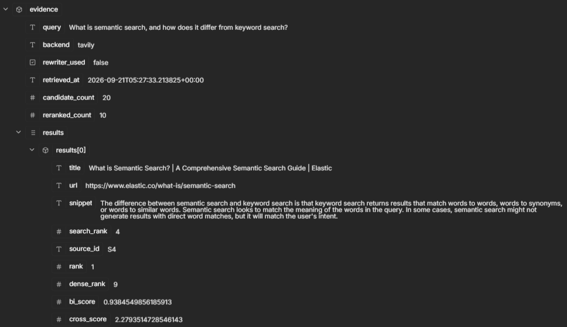

# Demo screenshots

The frontend screenshots show the working local website on 10 October 2026.
The n8n screenshots were provided by the author on 21 September 2026. Images
document recorded local executions, not a public hosted demo.

## Web frontend

The web interface calls the same Python ranking pipeline as MCP and n8n.

This browser execution used live Tavily results, both trained BERT checkpoints,
and Groq GPT-OSS 20B. Source citations navigate to matching result cards. Stage
timings describe this execution only; they are not additional benchmark results.

## Successful workflow

The workflow submits a question to the NSE HTTP endpoint, prepares a structured
request for local Ollama, then validates and returns the answer with its evidence.
Both trained BERT models run inside the service invoked by **Rank sources**;
they are not separate n8n nodes. This screenshot demonstrates the HTTP answer
workflow, not the separate native MCP workflow.

## Native MCP workflow

The manual trigger passes the query to n8n's native MCP Client node, labeled
**Rank sources**. All three nodes show successful execution. The supplied
[workflow configuration](../workflows/nse-mcp.json) calls `neural_search` at the
local NSE MCP endpoint. The canvas shows the execution status; it does not show
the tool parameters or returned evidence.

The MCP output exposes `structuredContent`, including the query, provider,
source metadata, and both model scores. This execution returned **18 candidates**
and reranked **10**. Its first result, **S5**, moved from provider rank **5** and
dense rank **2** to final rank **1**. The query includes a trailing `1.` as entered;
the screenshot is retained unchanged.

This is a separate retrieval at `2026-09-21T05:38:40.442215+00:00`. Its source IDs
belong to this execution and must not be matched to the answer screenshot below.

## Cited answer

The output identifies `qwen3:4b` and preserves the question and source citations.
It also explicitly records that factual verification was not performed. The
generated statement about accuracy is model output, not a measured project result.
The project's retrieval comparison is in the
[30-query evaluation](../evals/results/2026-09-21-tavily.md).

## Matching evidence

This source record matches the answer's **S4** citation. It contains the title,
URL, excerpt, and ranks at each stage: provider rank **4**, dense rank **9**, and
final rank **1**. The screenshot also shows 20 candidates and ten reranked items.
Scores describe model relevance; a citation match does not establish that every
claim in the generated answer is supported.

The evidence timestamp is `2026-09-21T05:27:33.213825+00:00`. Live search may return
different sources or ordering on a later run.

Use the [local setup guide](prototype.md) to reproduce the workflows or import
the [workflow JSON files](../workflows/). The
[validation record](prototype-validation.md) documents the independent MCP tests.
